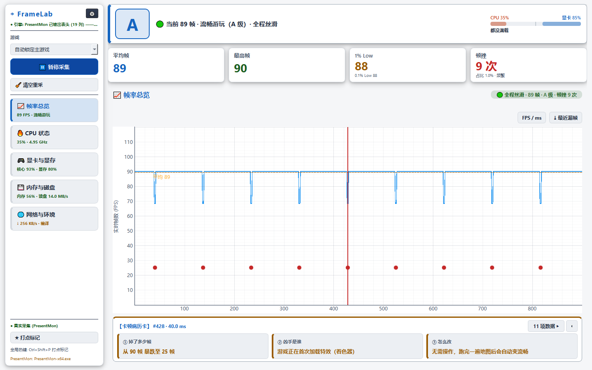

# StutterTriage

**Windows 游戏卡顿（掉帧）一站式体检台**

底层用 PresentMon + PDH/DXGI/ADL 采集，把「帧率掉了」翻译成玩家看得懂的一句话 + 一招解决建议。

> **开发**：该软件皆是由 **大肥鱼** 开发。

> **许可**：[MIT](LICENSE)。随包分发的 `external/PresentMon/PresentMon-x64.exe`
> 为 Intel 官方发行版（MIT），详见 [THIRD_PARTY.md](THIRD_PARTY.md)。



## 功能一览

- **帧时间体检**：FPS / 1% Low / 0.1% Low / 帧耗时 P99，实时曲线可滚轮缩放
- **卡顿归因**：把尖峰拆成 11 个维度（显存溢出 / CPU 单核拥堵 / 撞墙降频 /
  着色器编译 / 内存换页 …），给出**一句话结论 + 一招建议**
- **硬件心跳**：CPU 每核频率与占用、GPU 频率温度显存、内存换页、磁盘与网络
- **事件流**：自动告警 + 手动打点（全局热键）历史，可回看定位
- **CSV 回放**：导入 CapFrameX / PresentMon 导出的 CSV 离线分析
- **降级可用**：没有 PresentMon 时自动切模拟数据流，并在界面标注数据源，绝不冒充真实采样
- **多套皮肤**：浅色 / 深色 / 深空 / HUD / CapFrameX，全部支持热切换

---
## 1. 快速开始

```powershell
# 依赖（3 个，均为硬依赖）
python -m pip install -r requirements.txt      # PyQt6 / pyqtgraph / numpy

# 运行
python StutterTriage.py
```

- 需要 Windows 10 1709+ / Windows 11。
- **PresentMon 已随包内置**（`external/PresentMon/PresentMon-x64.exe`，Intel 官方 2.6.0 版），
  克隆后**开箱即用**，无需自行下载或安装。
- 即使把随包 PresentMon 移走也能用：程序自动降级为「模拟数据流」，并可用 `CSV 导入回放`
  分析 CapFrameX / PresentMon 导出的 CSV。
- 想改用自己版本的 PresentMon：把 `PresentMon.exe` 放到 exe 所在目录（或在 ⚙ 设置里指定路径）。
- 建议以管理员身份运行（完整 ETW 采集需要权限；非管理员会自动降级为模拟流）。

## 2. 目录结构（每个模块只干一件事）

```
StutterTriage.py                 启动器（薄壳）+ 旧顶层名字兼容导出
stuttertriage/
  paths.py                  「程序所在目录」的单一来源（配置/工具/提权脚本路径）
  theme.py                  主题系统：4 套配色 + 运行时热切换注册表 + pg 菜单汉化
  consts.py                 诊断阈值常量（可被 stuttertriage_config.json 覆盖，热更新广播）
  utils.py                  结构化日志 / 有界队列 / 格式化 / pg 符号校验
  probes.py                 底层 ctypes 探针：PDH、DXGI、AMD ADL、缓存目录监视、CPU 功率
  models.py                 Event / HardwareSnapshot / FrameRecord / DiffRow
  etw.py                    ETW 会话管家（根治 PresentMon error 1450 静默 0 帧）
  engines/hardware.py       HardwareEngine 轮询线程（CPU/GPU/显存/IO/网络/缓存/功率）
  engines/presentmon.py     PresentMon 定位与能力探测 + PresentMonBridge 采集线程
  analysis.py               BaselineTracker / FrameStore / SnapshotDiffInspector（11 维归因）
  config.py                 stuttertriage_config.json 读写与回落
  hotkeys.py                全局热键（RegisterHotKey + 原生事件过滤器）
  winadmin.py               管理员权限 / PresentMon 指引 / 数据源判定 / 模拟水印
  csvio.py                  CSV 后台读取（不冻结界面）
  stats.py                  帧率统计口径：平均/最高/1% Low/顿挫/评级/瓶颈（纯函数）
  ui/base_window.py         可复用窗口逻辑（设置页 / CSV / ETW / 热键 …）
  ui/main_window.py         主窗口装配（左栏导航卡 + 右侧 QStackedWidget + 每帧刷新口径）
  ui/navtabs.py             左侧 5 张大号视图导航卡（图标 + 模块名 + 一行实时状态徽章）
  ui/pages.py               QStackedWidget 的 5 个全屏页面（总览/CPU/显卡/内存/网络）
  ui/gauge.py               GamePP 风格图形元件（胶囊条/圆环/能量柱/频率柱/显存大横条/段位徽章）
  ui/chart.py               实时 FPS 曲线（渐变填充 + 均值虚线 + 顿挫红点 + 锁死坐标轴）
  ui/cpu_trend.py           CPU 折线：均频/功率总览 + 每线程一条（可滚动）折线
  ui/diagnosis.py           极简卡顿病历卡（idle/红/绿三态，高度恒定）+ 11 项专业对照表窗口
  ui/plain.py               小白话术映射表（专业归因 → 人话 + 解决建议）
  ui/widgets.py             通用可视化组件（CPU 热力块矩阵 / ElidedLabel / 探针读数条 / 进度条）
  app.py                    进程入口 main()
docs/                       设计资料（引擎 API 契约、迁移期 UI 清单、界面预览图）
assets/                     打包用图标（stuttertriage.ico 多尺寸 + 256px PNG 源图）
build_tools/                打包脚本与 PyInstaller 配置（build_exe.ps1 / StutterTriage.spec / version_info.txt）
dist/                       打包产物（StutterTriage.exe 单文件；旁边可放 stuttertriage_config.json）
tests/                      14 个可执行测试脚本（见 §4）
```

## 3. 测试

```powershell
# 全部（14 个脚本，纯逻辑 + 静态不变量 + offscreen 运行时冒烟 + 暗色可读性 + 退出清理 + 版面零抖动）
Get-ChildItem tests\*.py | Where-Object { $_.Name -ne 'render_preview.py' -and $_.Name -notlike '_*' } | ForEach-Object { python $_.FullName }

# 单独跑
python tests\test_v1_layout.py            # 版面零抖动 / 折线去重 / 换肤持久化 / 归因表可读性 / 每线程窗口 / 换页归因 / 白底对比度 / 面板与设置 / 手动开始采集与清空重采
python tests\test_algofix.py              # 3 个算法修复：爆显存门控 / 降频门控 / 顿挫双重门控（正+负用例）
python tests\test_chart_axis.py           # 坐标轴：空载 0~100 / FPS 0~144 / ms 0~35 + 参考虚线
python tests\smoke_v4_runtime.py          # 端到端：导航卡/五页/徽章/病历卡红绿两态/坐标轴/降频/显存门控
python tests\test_dark_settings_readability.py  # 暗色主题下 菜单/设置页/弹窗 对比度 ≥ WCAG AA（4 主题）
python tests\test_close_cleanup.py        # 关闭后无残留窗口 / 无孤儿 PresentMon（含 Job 联动杀验证）
python tests\test_static_integrity.py     # 拆分不变量：无漏 import / 无冻结常量 / 主题广播 / 路径来源
python tests\test_plain_and_stats.py      # 小白话术映射 + 帧率口径 + 评级 + 阈值广播
python tests\test_theme.py                # 主题/热键/图表样式契约
python tests\test_ux.py                   # 59 项 UX 契约（配置/数据源/水印/热键/黑名单/CSV/ETW/打点）
python tests\test_regression.py           # 阻断级缺陷回归（时间轴单位、导入失败复位、基线鲁棒性…）
python tests\test_lifecycle.py            # 生命周期：线程可 join、无 ETW 残留
python tests\smoke_ux_runtime.py          # 旧 UX 冒烟（导入/水印/导出列/关闭流程）
python tests\render_preview.py            # 渲染界面预览图到 docs/preview_*.png（需真实 windows 平台）
```

`render_preview.py` 生成的预览图：`docs/preview_deepspace.png`（总览·深空黑）、
`docs/preview_light.png`（总览·浅色）、`docs/preview_ms_view.png`（ms 视角）、
`docs/preview_page_cpu.png` / `_gpu.png` / `_mem.png` / `_net.png`（四张导航页）、
`docs/preview_settings_dark.png` / `_light.png`（⚙ 设置页：中文分组表单 + 暗/浅两套对比度证据）。

## 4. 打包成 EXE（PyInstaller）

产物：`dist\StutterTriage.exe`（单文件、免安装、便携）。

```powershell
# 一条命令：创建/复用构建环境 → 打包 → 输出 dist\StutterTriage.exe
pwsh -File build_tools\build_exe.ps1

# 重建构建环境（PyInstaller 升级 / 环境损坏时）
pwsh -File build_tools\build_exe.ps1 -RebuildVenv
```

| 项 | 说明 |
|---|---|
| 构建环境 | 默认在**项目外**：`<项目>\..\_build_env\stuttertriage_venv`（venv + `--system-site-packages`，复用系统已装的 PyQt6/pyqtgraph/numpy，只额外装 PyInstaller）。可用 `-Venv <路径>` 或环境变量 `STUTTERTRIAGE_BUILD_VENV` 覆盖 |
| 中间产物 | PyInstaller 的 work 目录也在项目外（`_build_env\work`），打完自动清掉，项目里只留 `dist\` |
| 体积 / 耗时 | 约 **50 MB**、**45~60 秒**（本机 1.0.0 实测：50.3 MB / 46 秒；Python 3.11 + PyQt6 6.11 + numpy 2.4 + pyqtgraph 0.14） |
| 启动耗时 | 单文件模式约 **4 秒**（每次启动要先把 50MB 解包到 `%TEMP%\_MEI*`）。若嫌慢，把 spec 里的 `EXE(...)` 改成 `COLLECT(...)` 出 onedir 版即可（文件夹形式，启动 <1 秒） |
| 图标 / 版本 | `assets\stuttertriage.ico`（16~256 多尺寸，与深空黑主题同色）+ `build_tools\version_info.txt`（资源管理器「属性→详细信息」里显示 1.0.0.0） |
| 隐藏导入 | spec 里用 `collect_submodules("stuttertriage")` 显式列出全部子模块，防止「函数内延迟导入」被静态分析漏掉 |

**便携式行为（重要）**：`stuttertriage/paths.py` 已按 `sys.frozen` 分支处理 ——
打包后「程序目录」= **exe 所在目录**。所以：

- `stuttertriage_config.json` 会生成/读取 **exe 旁边**那一份（不是项目目录里的）；
  想沿用源码里的设置，把 `stuttertriage_config.json` 复制到 exe 同目录即可。
- PresentMon 查找顺序不变（exe 目录 → `PresentMon\` 子目录 → PATH → 设置里指定的路径）。
- 运行日志仍写在 `%USERPROFILE%\.stuttertriage\stuttertriage_diag.log`（不污染程序目录）。

**已验证**（本机实测）：从项目目录启动、复制到其他目录启动都正常；
窗口标题 `StutterTriage 1.0.0 · 游戏卡顿一站式体检台`；界面/实时数据/图表全渲染；
配置沿用用户设置且未被改写；关闭后 **无残留 StutterTriage / PresentMon 进程**。

> 提示：普通双击启动时，程序会在 700ms 后弹一次「以管理员身份运行可获得完整采集能力」的提醒
> （ETW 需要管理员）。**右键 exe → 以管理员身份运行** 就不会有这个提醒。

## 5. 配置与日志

| 文件 | 位置 | 说明 |
|---|---|---|
| `stuttertriage_config.json` | 与 `StutterTriage.py` 同目录 | 主题、图表样式、热键、PresentMon 路径 + 12 个诊断阈值；脏值一律回落默认，不会让程序起不来 |
| `stuttertriage_diag.log` | `%USERPROFILE%\.stuttertriage\` | 结构化异常日志（关键路径异常必留痕、同类限频） |

路径来源统一由 `stuttertriage/paths.py` 提供（拆分后踩过的坑：`__file__` 变成包目录，
配置被写进 `stuttertriage/` 导致用户旧配置失效）。

## 6. 参与贡献

欢迎提交 Issue 与 Pull Request。

### Issue 请附带

- 操作系统版本（`winver` 输出）、显卡型号与驱动版本
- StutterTriage 版本（标题栏 / `stuttertriage/__init__.py` 的 `__version__`）
- 是否以管理员身份运行
- `%USERPROFILE%\.stuttertriage\stuttertriage_diag.log` 的相关片段（该日志只记本地诊断，不含个人信息）

### 开发约定（源自本项目自身的踩坑记录，请勿轻易推翻）

1. **UI 层不得改动采集与归因语义**。归因算法可以改，但"何时调用、调用频率"必须留证据再改。
2. **主题色不得写死十六进制**，一律映射到主题角色名（`bad` / `warn` / `green` / `dim`），
   在访问时解析；浅色主题语义色对白底对比度需 >= 4.5:1。
3. **配置保存必须广播**：`Config.apply_to_globals()` **不带参数**，让它广播到所有已注册模块；
   传 `globals()` 只会更新本模块副本，会导致"看着保存了但要重启才生效"。
4. **高频路径必须节流**：30Hz 路径上做 O(会话) 计算会直接淹没 UI 定时器，
   节流常量写在 `main_window` 的类属性里，便于集中调参。
5. **ctypes 回调分配的内存，生命周期必须由驱动接管**（AMD ADL 用驱动自己的 `free()`），
   不能把 Python 缓冲区的裸地址交出去 —— 会 use-after-free，表现为随机闪退。
6. **退出必须收干净**：顶层窗口要全部关掉（否则 Qt 不退出），子进程用 Job Object 兜底，
   重复 `deleteLater()` 会让 PyQt6 在解释器收尾时 fastfail。

### 跑测试

```powershell
# 全部（14 个脚本）
python -m pip install -r requirements.txt
$env:QT_QPA_PLATFORM = "offscreen"
Get-ChildItem tests\*.py | ForEach-Object { python $_.FullName }
```

> `tests/render_preview.py` 必须用 `QT_QPA_PLATFORM=windows` 跑（offscreen 渲染不出中文字体）。
## 7. 已知限制

- 仅 Windows；真实采集需要 PresentMon（本仓库已内置）与（完整 ETW 场景下的）管理员权限。
- **PyQt6 采用 GPL-3.0 / 商业双许可**。本项目以 MIT 发布；若你打算将其用于**闭源商业软件**，
  请改用 [PySide6](https://pypi.org/project/PySide6/)（LGPL-3.0）或向 Riverbank 购买 PyQt 商业许可。
- 1% Low 用帧耗时 P99 换算；样本 < 1000 帧时 0.1% Low 会退化为 P99（界面会标注）。
- 最高帧取的是窗口内最高**瞬时**帧率，切屏/加载瞬间的极端值会拉高它，属预期口径。
- 「模拟数据」会在图表上打水印并在侧栏标注数据源，避免被误当真实采集。
- 折线图**默认**每帧重新锁定坐标轴范围（这是「严禁乱码/严禁窄区间」的代价）；
  一旦你手动滚轮/拖拽缩放，就会停止自动锁轴、保留你的视野，直到切换 FPS/ms 视角
  或「🧹 清空重采」才复位。
- 显卡频率门控依赖驱动上报（AMD ADL / NVIDIA NVML）；本机未上报时该行标注「不可判定」，
  不会给出假结论。
- **单文件 EXE 被强杀会残留 `%TEMP%\_MEI*`**（约 120 MB/次）——这是 PyInstaller 单文件模式的
  固有行为（解包目录靠正常退出时清理）。正常关闭不残留；强杀后可手动删掉 `%TEMP%\_MEI*`。
- PresentMon 与 ETW 会话已用 Job Object 兜底：StutterTriage 一死它们必然跟着结束；
  但 `logman stop` 需要管理员权限，非管理员强杀后 ETW 会话可能残留 Running，
  下次启动会自动清理（`PresentMonBridge` 启动前 `cleanup_stale()`）。
